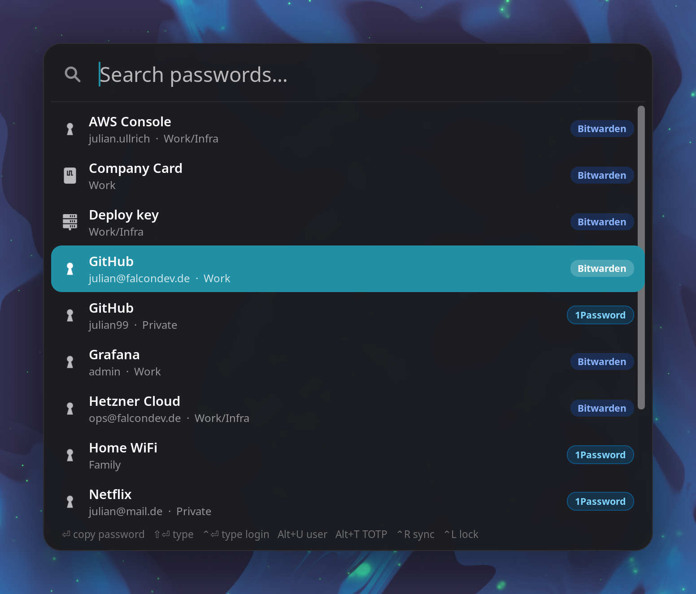
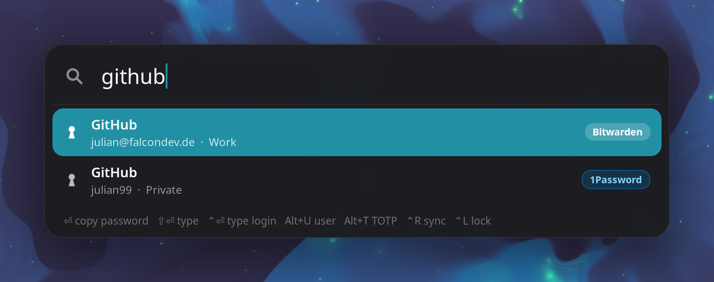
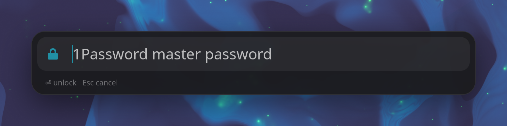

# Quick Launcher

A GNOME Shell extension with Spotlight-style launchers for your passwords and your Clockify timer.

Search **Bitwarden** and **1Password** in one list, copy or type a password, and see which vault
every entry comes from. Locked vaults unlock right in the launcher. A second launcher starts
Clockify timers from your recent entries.

<p align="center">
  
</p>

## Features

- One search over Bitwarden (via [rbw](https://github.com/doy/rbw)) and 1Password (via the
  [`op` CLI](https://developer.1password.com/docs/cli/)), each entry tagged with its source
- Unlock either vault from the launcher: type the master password there, or hand over to the
  1Password app
- Copy or type passwords, usernames and TOTP codes; typing works on Wayland without ydotool
- Copied secrets are cleared after 30 seconds and removed from Clipboard Indicator's history
- Clockify: restart any recent entry, or a new one with `@project` and `#tag`
- Opens instantly with what it already knows and refreshes in the background

Quick Launcher supports GNOME Shell 48, 49 and 50. It works with either password manager on its
own or with both.

## Install

Download the zip from the [latest release](https://github.com/TheSalaty/quick-launcher/releases/latest),
then run:

```sh
cd ~/Downloads
```

Then run:

```sh
gnome-extensions install --force quick-launcher@julian.falcondev.de.shell-extension.zip
```

Log out and back in, then enable the extension:

```sh
gnome-extensions enable quick-launcher@julian.falcondev.de
```

On Arch and Manjaro, [`packaging/PKGBUILD`](packaging/PKGBUILD) builds a system-wide package.

### From source

Requires Node.js 22 or newer and pnpm.

```sh
git clone https://github.com/TheSalaty/quick-launcher.git
cd quick-launcher
pnpm install
make install
```

Log out and back in before enabling the extension. Run `make pack` to build an installable zip.

## Passwords

Press <kbd>Ctrl</kbd><kbd>Shift</kbd><kbd>Enter</kbd> and start typing. Every word is matched
against name, username, URLs and folder, the way the Bitwarden clients search.

<p align="center">
  
</p>

| Key | Action |
| --- | --- |
| <kbd>Enter</kbd> | copy password (on a locked vault: unlock it) |
| <kbd>Shift</kbd><kbd>Enter</kbd> | type password, then Enter |
| <kbd>Ctrl</kbd><kbd>Enter</kbd> | type username, Tab, password, Enter |
| <kbd>Alt</kbd><kbd>P</kbd> / <kbd>U</kbd> / <kbd>T</kbd> | copy password / username / TOTP code (add <kbd>Shift</kbd> to type it) |
| <kbd>Ctrl</kbd><kbd>R</kbd> | sync and reload |
| <kbd>Ctrl</kbd><kbd>L</kbd> | lock all vaults |
| <kbd>Esc</kbd> | close, or cancel a password prompt |

The last search and the last-used entry come back when you open the launcher, so pressing
<kbd>Enter</kbd> repeats what you did last.

### Unlocking

A locked vault shows up as an **Unlock** row. Press <kbd>Enter</kbd> on it.

<p align="center">
  
</p>

- **1Password**: with *Settings → Developer → Integrate with 1Password CLI* turned on in the app,
  the app asks (system authentication or fingerprint). Without the app, you type the master
  password into the launcher. It goes to `op signin` on stdin, and the session token stays in
  memory.
- **Bitwarden**: rbw always asks through a pinentry program. Turn on *Enter master password in
  the launcher* in the settings to get that prompt in the launcher. Without it, your usual
  pinentry asks and the launcher comes back afterwards.

## Clockify

Press <kbd>Shift</kbd><kbd>Alt</kbd><kbd>Enter</kbd>. Your recent entries are listed newest first,
with when you last worked on them. The running timer is on top.

<p align="center">
  
</p>

| Key | Action |
| --- | --- |
| <kbd>Enter</kbd> | start the selected entry, or stop it if it is running |
| <kbd>Shift</kbd><kbd>Enter</kbd> | start a new entry from the typed text |
| <kbd>Ctrl</kbd><kbd>S</kbd> | stop the running timer |
| <kbd>Ctrl</kbd><kbd>R</kbd> | reload |

In a new entry, `@proj` picks the first matching project and `#tag` adds tags, for example
`Standup @falcon #meeting`. Starting a timer stops the running one at the same second, so there
are no gaps.

## Settings

```sh
gnome-extensions prefs quick-launcher@julian.falcondev.de
```

You can change both shortcuts, turn each password manager on or off, set the rbw and op
binaries, the 1Password account and unlock method, how long copied secrets stay on the clipboard,
and the Clockify API key. Workspaces on a regional Clockify server need the matching API URL,
for example `https://euc1.clockify.me/api/v1`.

## Notes

- Only names, usernames, folders and URLs are kept in memory. Passwords and TOTP codes are
  fetched when you use them.
- The 1Password session from a typed master password expires after 30 minutes without use. The
  vault then shows up as locked again.
- The Bitwarden pinentry bridge changes rbw's `pinentry` setting. Turning it off restores the
  previous value. While the extension isn't running, the bridge passes prompts on to that
  pinentry.
- The last Clockify entries, projects and tags are cached in `~/.cache/quick-launcher/`, so the
  list shows up right away after a restart.

For development notes, see [docs/DEVELOPMENT.md](docs/DEVELOPMENT.md).

## License

[MIT](LICENSE). Quick Launcher is not affiliated with Bitwarden, 1Password or Clockify.
